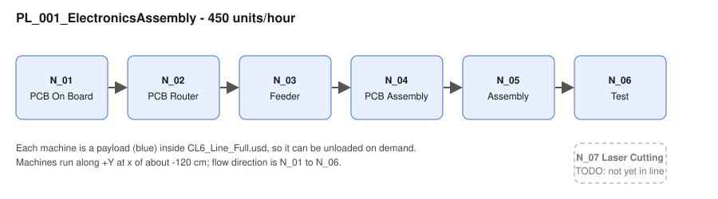
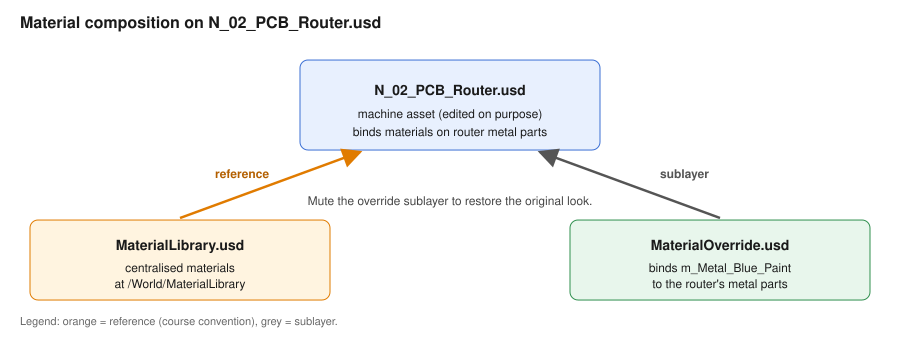

# Digital Twin Assembly

A digital twin of an electronics (PCB) production line, assembled in OpenUSD from ready-made machine and factory assets. It follows NVIDIA's [Assembling Your First Digital Twin With Omniverse and OpenUSD](https://docs.nvidia.com/learning/physical-ai/assembling-digital-twins/latest/index.html) course and uses its `PhysicalAI_SceneAssembly` dataset. The point of the project is the composition: small layers stacked with sublayers, references and payloads, so the source assets stay untouched and every change can be muted or swapped.

The machine and factory assets, and the course material, belong to NVIDIA and its content partners. This repo is a learning project built on them, not an NVIDIA product.

## Layer stack

`scenes/assemblies/DigitalTwin.usd` is the root stage (Z-up, centimetres).

```
DigitalTwin.usd                         root stage
├─ sublayer  ProductionLines.usd        repositions machines; rotate 90 / scale 0.1 (Y-up to Z-up)
│   └─ reference  Machine_Asssembly.usd
│       └─ reference  CL6_Line_Full.usd   production line PL_001_ElectronicsAssembly, 450 units/hour
│           └─ payloads  N_01 .. N_06 machines (assets/original/.../Machine_USD)
├─ sublayer  FactoryProps.usd           props layer (no prims yet)
├─ sublayer  Materials_Samples.usd      course factory layers
├─ sublayer  Factory_Floor_Walkways.usd
├─ sublayer  SetDressing.usd
├─ sublayer  Lighting.usd
├─ sublayer  FactoryWaypoints.usd       navigation waypoints (/Viewport_Waypoints)
└─ payload   Factory_Shell_Adjust.usd   at /World/Samples/Factory_Shell_Adjust
```

### Materials
Materials are composed into the machine asset rather than the root stage. `N_02_PCB_Router.usd` references `scenes/assets/material/MaterialLibrary.usd` at `/World/MaterialLibrary`. It also sublayers `scenes/assets/material/MaterialOverride.usd`, which binds `m_Metal_Blue_Paint` to the router's metal parts. Muting that sublayer restores the original look.

## Repository map

| Path                                        | What it is                                                                                                                                                                              |
|---------------------------------------------|-----------------------------------------------------------------------------------------------------------------------------------------------------------------------------------------|
| `scenes/assemblies/`                        | The layers above: `DigitalTwin`, `ProductionLines`, `Machine_Asssembly`, `CL6_Line_Full`, `FactoryProps`                                                                                |
| `scenes/assets/material/`                   | `MaterialLibrary.usd` and `MaterialOverride.usd`                                                                                                                                        |
| `scenes/assets/props/`                      | Collected `InstrumentCart_A02_01` prop (not yet placed in the scene)                                                                                                                    |
| `assets/original/PhysicalAI_SceneAssembly/` | NVIDIA course dataset: seven machines (N_01 to N_07), factory shell, materials. `N_02_PCB_Router.usd` was edited on purpose to add the material library reference and override sublayer |
| `kit-app-template/`                         | Unmodified NVIDIA Kit App Template (Kit 109.0.3), the base for building the app                                                                                                         |
| `assets/learning/Physical-AI-Learning-KAT/` | An earlier "Physical AI Learning" Kit app (Kit 107.3.0) generated from the template                                                                                                     |

## Visuals

Renders of `DigitalTwin.usd` captured headless in the Kit app (RTX). Images are in `docs/media/`, the scripts that made them are in `docs/capture/`.

### Factory and production line


*The full factory hall with the PL_001 production line in context.*


*The PL_001 line, machines N_01 to N_06, seen from the front.*


*Process flow of the line at 450 units/hour, with N_07 still to be added.*

### Individual machines and placement


*N_02 PCB Router with the blue paint override applied.*


*N_03 Feeder, with SCARA pick-and-place arms and conveyors.*


*Close-up of the alignment between neighbouring machines.*

### Materials


*How MaterialLibrary.usd and MaterialOverride.usd compose into N_02_PCB_Router.usd.*

### Factory navigation waypoints

Five waypoints are authored in `scenes/assemblies/FactoryWaypoints.usd` (a sublayer of `DigitalTwin.usd`, mute it to remove them), following the course lesson on navigation waypoints. In Composer, open the Waypoint button in the viewport menu bar to step through them.


*Waypoint `Factory_Overview`: whole hall with the line in context.*


*Waypoint `Production_Line_Overview`: main assembly line, N_01 to N_06.*


*Waypoint `N02_PCB_Router_Station`: router with the blue paint override.*


*Waypoint `N03_Feeder_Station`: feeder station.*


*Waypoint `N06_Test_Station`: the test machine at the end of the line.*

### Regenerating the images

Needs the built Kit app and an RTX GPU. Run from the repo root; the scripts are in `docs/capture/`:

```
KIT=kit-app-template/_build/linux-x86_64/release/ellie.usd_composer.kit.sh
SHOT_DIR=docs/media $KIT --exec docs/capture/capture_shots.py
$KIT --enable omni.kit.waypoint.core --enable omni.kit.viewport.menubar.waypoint --exec docs/capture/setup_waypoints.py
SHOT_DIR=docs/media $KIT --enable omni.kit.waypoint.core --enable omni.kit.viewport.menubar.waypoint --exec docs/capture/capture_waypoints.py
```

`shots.py` holds the camera positions, `inspect_stage.py` prints the stage hierarchy with bounding boxes. `setup_waypoints.py` rewrites `FactoryWaypoints.usd`, so delete that file first when re-running it.

## Running it

**Open the scene.** All `.usd`, `.mdl` and image files are stored with Git LFS, so a plain clone contains only placeholder pointers.

1. Install Git LFS (on macOS without Homebrew, use the binary from the [git-lfs releases page](https://github.com/git-lfs/git-lfs/releases) and run its `install.sh`).
2. `git lfs install && git lfs pull`
3. Open `scenes/assemblies/DigitalTwin.usd` in USD Composer, Kit or Isaac Sim.

Machine and factory paths are relative, so keep the folder layout as it is.

**Build the Kit app (optional).** Needs Linux or Windows with an RTX GPU; Kit does not run on macOS.

```
cd kit-app-template
./repo.sh build      # repo.bat build on Windows
./repo.sh launch
```

## Status
- Done: production line assembly from machine payloads, factory floor, shell, lighting and set dressing, and a material override on the PCB router; five navigation waypoints.
- TODO: in `FactoryProps.usd` reference the instrument cart, set N_07_Laser_Cutting in the line, and add material override.
